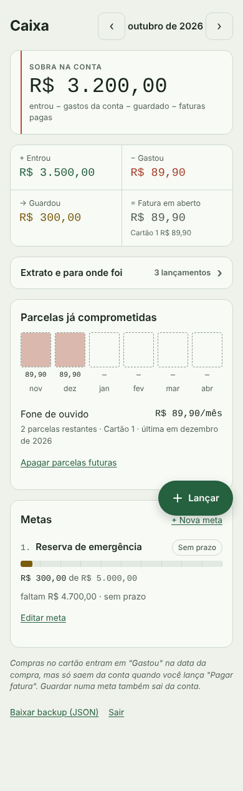
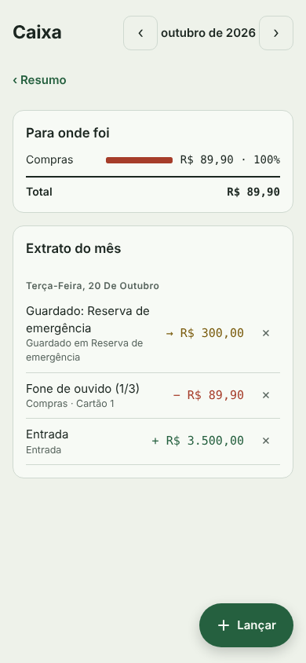

# Caixa

> **Projeto pessoal em construção.** Uso ele no meu dia a dia, mas ainda estou
> ajustando partes do código e revisando decisões de implementação. Não
> recomendo usar como base para nada em produção.

Livro-caixa pessoal pro celular. Responde três perguntas: quanto sobrou na conta este mês, pra onde o dinheiro foi e quanto falta pra cada objetivo.

<p>
  
  
</p>

## O que ele faz

- **Sobra na conta:** entradas menos gastos pagos na conta, menos o que foi guardado, menos faturas pagas.
- **Cartão de crédito do jeito certo:** a compra no cartão entra em "Gastou" na data da compra, mas só sai da conta quando você registra o pagamento da fatura. Assim nada é contado duas vezes.
- **Parcelamentos:** lance "parcela 3 de 10" uma vez e as próximas parcelas aparecem nos meses certos. Um quadro mostra quanto já está comprometido nos próximos 6 meses.
- **Metas:** alvo, prazo e quanto guardar por mês pra chegar lá.
- **Extrato e categorias** de cada mês.
- **Backup** em JSON a qualquer momento.

Cada valor tem cor e sinal próprios: `+` entrada, `−` gasto, `→` guardado, `=` pagamento de fatura. Parcelas futuras aparecem com contorno tracejado.

## Tecnologia

- Front: HTML, CSS e JavaScript, sem framework e sem etapa de build. Um único `index.html`.
- Banco: PostgreSQL no [Supabase](https://supabase.com), com login por e-mail e senha.
- Hospedagem: GitHub Pages (ou qualquer hospedagem de arquivos estáticos).

## Segurança

- As tabelas usam **Row Level Security**: cada usuário só lê e grava as próprias linhas. As regras estão em [`supabase/schema.sql`](supabase/schema.sql).
- O `config.js` traz a URL do projeto e a chave **publishable** (ou a antiga **anon**). As duas são públicas por design. Sem login, essa chave não acessa nenhum dado.
- As chaves **secret** e **service_role** nunca entram no front nem no repositório.
- Recomendado para uso pessoal: crie seu usuário pelo painel e **desative novos cadastros** (passo 3 abaixo). Assim ninguém mais consegue criar conta no seu projeto.

## Como instalar

### 1. Criar o projeto no Supabase

1. Crie uma conta em supabase.com e um projeto novo (o plano gratuito basta).
2. Abra **SQL Editor**, cole o conteúdo de `supabase/schema.sql` e rode.

### 2. Criar seu usuário

Em **Authentication → Users → Add user**, crie o usuário com e-mail e senha. Marque a opção de confirmar o e-mail automaticamente.

### 3. Fechar o cadastro

Em **Authentication → Sign In / Providers**, desative **Allow new users to sign up**. O app não tem tela de cadastro, mas desativar aqui garante que ninguém crie conta pela API.

### 4. Configurar o app

No botão **Connect** do painel (ou em **Project Settings → API Keys**), copie a **Project URL** e a chave **publishable** (`sb_publishable_...`) para o `config.js`. No mesmo arquivo, ajuste seus cartões, categorias e atalhos.

O `id` de cada cartão fica gravado nos lançamentos. Escolha uma vez e não mude.

### 5. Publicar no GitHub Pages

1. Suba os arquivos para um repositório.
2. Em **Settings → Pages**, escolha **Deploy from a branch**, branch `main`, pasta `/ (root)`.
3. Em **Authentication → URL Configuration** no Supabase, coloque o endereço do Pages (`https://SEU-USUARIO.github.io/caixa/`) em **Site URL**.

### 6. Atalho no celular

Abra o endereço no Chrome, toque em **⋮ → Adicionar à tela inicial**. O app abre em tela cheia, com ícone próprio.

## Rodar localmente

Qualquer servidor estático serve:

```bash
python3 -m http.server 8000
# abra http://localhost:8000
```

## Estrutura

```
index.html             app inteiro (HTML, CSS e JS)
config.js              URL do Supabase, chave anon, cartões, categorias e atalhos
supabase/schema.sql    tabelas, índices, Row Level Security e tempo real
manifest.webmanifest   instalação na tela inicial
icon.svg               ícone
```

## Próximos passos

- [ ] Editar um lançamento sem precisar apagar e lançar de novo
- [ ] Importar o extrato do banco (OFX/CSV)
- [ ] API própria em Django REST como alternativa ao Supabase
- [ ] Gráfico de evolução da sobra mês a mês

## Licença

[MIT](LICENSE)
